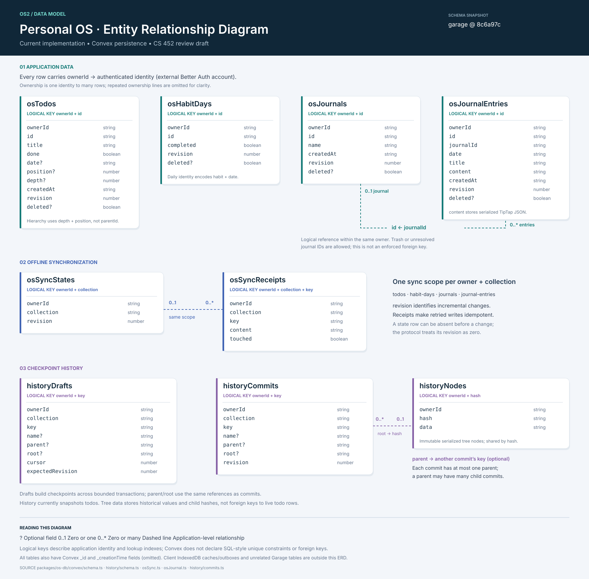
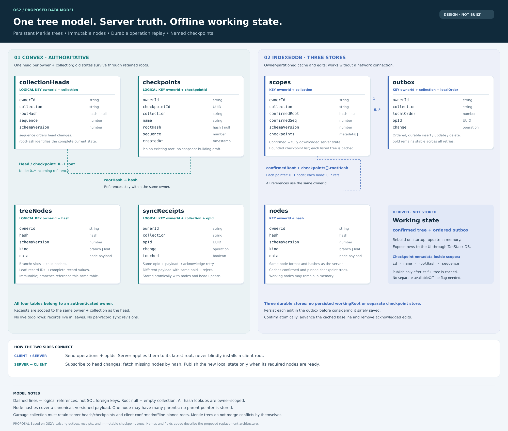
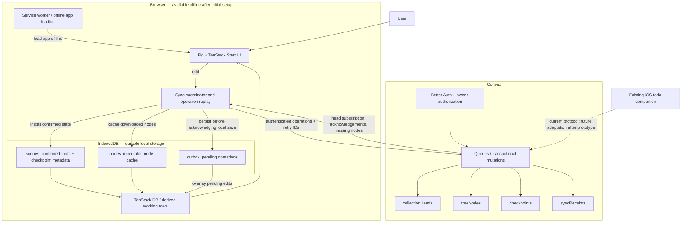

# OS2 — Initial Project Design

**CS 452 · Benjamin Gubler · November 19, 2026**

## Purpose and goals

OS2 is my offline-capable personal productivity app for tasks, habits, and journaling. I want a tool that responds immediately, remains useful without a connection, and brings changes back across devices when connectivity returns. It is also a practical place to explore data modeling, synchronization, and versioned storage in software I actually use.

My goals are to improve offline reliability, make saved task checkpoints easy to understand and compare, and evaluate whether one immutable tree representation can support both current data and history. I will use AI to help design, implement, review, and test the software.

## Existing foundation and proposed work

This project extends OS2 in [bgub/garage](https://github.com/bgub/garage). Existing work includes the web app, an iOS todo companion, authenticated Convex persistence, a durable offline outbox, task and habit features, journals, and task checkpoint history. The [project log](PROJECT_LOG.md) records the earlier work separately.

Today, live records and immutable checkpoint trees are separate. The design below proposes making a content-addressed, persistent Merkle tree the authoritative collection state. This change is **not implemented yet**. I will prototype it with todos first and compare it with the existing approach before deciding whether to expand it. A successful project includes an honest evaluation; adopting the new design everywhere is not a prerequisite.

Planned outcomes:
- A working offline editing and reconnect demonstration.
- A bounded prototype of tree-backed todo storage and synchronization.
- Tests for retry safety, concurrent devices, reload recovery, and checkpoint preservation.
- A documented comparison of storage, query cost, and implementation complexity.
- Peer feedback, an in-class demonstration, and a final report.

## Initial entity relationship diagrams

### Existing implementation

The existing model stores live todos, habits, journals, and entries in Convex tables. Collection revisions and write receipts support synchronization; separate immutable nodes and commits preserve task checkpoints.

### Proposed architecture

[Open the proposed ERD at full size](diagrams/os2-proposed-erd.svg).

The server would store:
- **collectionHeads:** current root hash and sequence for each owner and collection.
- **treeNodes:** immutable branch and leaf nodes, addressed by a hash of their canonical, versioned contents. Leaves contain records; branches contain child hashes.
- **checkpoints:** named references to retained roots.
- **syncReceipts:** operation IDs and payloads used to acknowledge retries without applying edits twice.

The browser would use three IndexedDB stores:
- **scopes:** confirmed root/sequence and a bounded list of fully cached checkpoint metadata.
- **nodes:** immutable cached nodes for confirmed and pinned checkpoint trees.
- **outbox:** ordered pending operations with stable retry IDs.

Working state is derived from the confirmed tree plus pending operations. It does not require a persisted working-root field. All references are scoped to the authenticated owner. Empty collections use a null root. The diagram shows logical relationships, not SQL foreign keys.

## Rough system design

The diagram shows the proposed browser synchronization path. The existing iOS companion shares the backend; adapting it to the new protocol would follow a successful todo prototype.

### Editing and reconnect behavior

1. Persist an edit in the local outbox and immediately show its effect in the working view.
2. When connected, send ordered operations with stable IDs. The server applies them to its latest tree, rather than replacing the head with a potentially stale client root.
3. In one bounded transaction, save newly created nodes, advance the head, and record receipts.
4. Download any required nodes missing from the local cache. Only then atomically advance the confirmed local baseline and remove acknowledged operations.
5. Reapply remaining pending edits over the new baseline.

Named checkpoints pin existing roots. Unchanged branches are shared across versions. The client subscribes to head changes and can skip downloading nodes already cached by hash.

### Design questions to test

- **Conflicts:** the tree does not merge edits automatically. Field patches can preserve changes to different fields; competing writes to one field need a defined policy. Rich-text body replacement remains a limitation.
- **Performance:** compare path-copying and root contention against current row updates. Bound transactions and fetch nodes in batches.
- **Queries:** embedded leaf values are not directly indexed by Convex. Keep client-side derived views for the prototype and measure before adding secondary indexes.
- **Recovery:** test dropped acknowledgements, duplicate delivery, offline reloads, and a second device editing during disconnection.
- **Retention:** preserve nodes reachable from active heads, checkpoints, and locally pinned roots. Defer destructive garbage collection until retention rules are tested.
- **Migration:** prototype with isolated test data first; preserve the working application while evaluating the replacement.

## Initial daily goals

These are provisional goals, not completed work or hours already claimed. I will revise them after feedback and record actual time in the project log. The remaining work should bring the project toward the course's 30–40-hour total, including at least three hours of collaboration.

| Date | Goal |
| --- | --- |
| Nov. 19 | Submit this design; pitch to a classmate, obtain feedback, and post the required Teams summary. |
| Nov. 20 | Define todo-prototype acceptance criteria, operation shapes, and conflict behavior. |
| Nov. 21 | Prototype immutable node storage and atomic collection-head updates with test data. |
| Nov. 22 | Prepare the Nov. 23 demo; explain existing features and the proposed architecture clearly. |
| Nov. 23 | Present current progress to the class and record feedback. |
| Nov. 24 | Implement or refine the three-store IndexedDB prototype and startup replay. |
| Nov. 25 | Test offline edits, browser reloads, and reconnect recovery. |
| Nov. 26 | Buffer/rest day; capture design notes only if needed. |
| Nov. 27 | Test duplicate delivery, lost acknowledgements, and ordered replay. |
| Nov. 28 | Test two-device edits and document conflict outcomes. |
| Nov. 29 | Review checkpoint pinning and offline checkpoint viewing. |
| Nov. 30 | Compare prototype read/write costs with the existing design; decide whether to expand it. |
| Dec. 1 | Address the highest-priority issues found in the comparison. |
| Dec. 2 | Review the design with peers and give feedback on their projects. |
| Dec. 3 | Assess iOS protocol compatibility; adapt only if the prototype is stable and time permits. |
| Dec. 4 | Run regression checks and document limitations and recovery behavior. |
| Dec. 5 | Improve the demo flow and finish any essential usability fixes. |
| Dec. 6 | Buffer/rest day; review outstanding work and the time log. |
| Dec. 7 | Incorporate final peer feedback and update diagrams to match the actual outcome. |
| Dec. 8 | Record the demo and draft the final report, including key learnings and AI usage. |
| Dec. 9 | Finish the collaboration report, verify links, and reconcile the work log. |
| Dec. 10 | Submit the final report, class-channel post link, and collaboration PDF. |

The presentation is scheduled for Nov. 23; the assignment permits continued project work afterward. The final project and collaboration reports are due Dec. 10.

## AI assistance

AI has assisted with reconstructing the work log, explaining architectural alternatives, and preparing this initial design and its diagrams. The log distinguishes retrospective estimates from measured sessions; unattended AI execution time is not counted.
