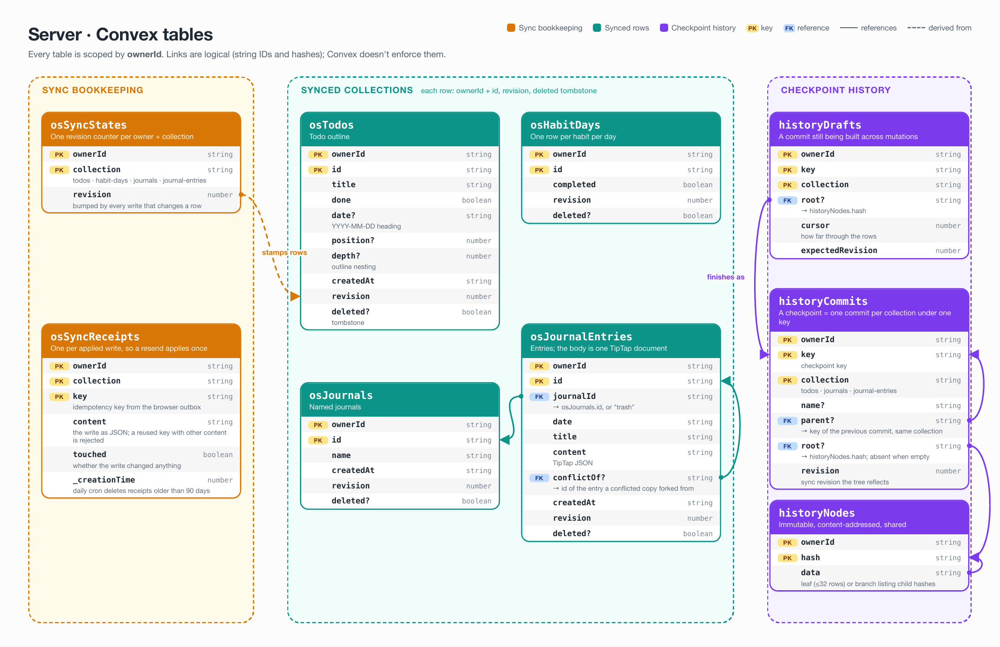
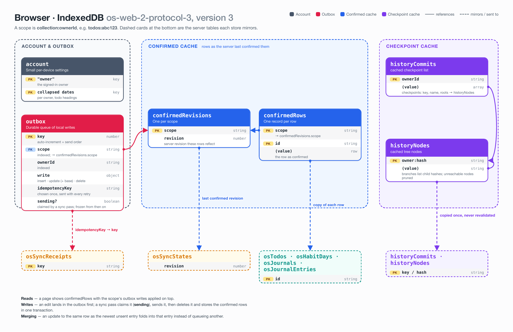
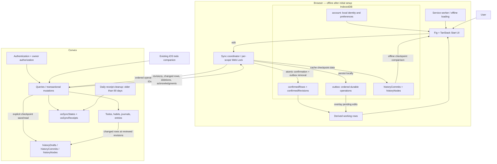

# OS2 — Project Design

**CS 452 · Benjamin Gubler · Initially submitted November 19, 2026 · Updated November 20, 2026**

## Purpose and goals

OS2 is my offline-capable personal productivity app for tasks, habits, and journaling. I want a tool that responds immediately, remains useful without a connection, and brings changes back across devices when connectivity returns. This project explores reliable synchronization, conflict preservation, and understandable checkpoint history in software I use myself. AI assists with design, implementation, review, and testing.

## Scope and current architecture

This project extends OS2 in [bgub/garage](https://github.com/bgub/garage). The existing foundation includes the web app, an iOS todo companion, authenticated Convex persistence, and offline editing. The [project log](PROJECT_LOG.md) records work and actual estimated hours.

**Decision:** retain ordinary indexed Convex rows as authoritative live data. The earlier proposal to replace live tables with a Merkle-tree source of truth was not adopted. Immutable content-addressed trees remain specifically for checkpoint history. The earlier proposal diagrams remain in Git history and in the diagrams directory as historical artifacts; they do not describe the current design.

The current implementation, reviewed through Garage commit `649c3af`, includes:

- Per-collection revisions and durable operation receipts for incremental sync and retry safety.
- IndexedDB storage of confirmed rows individually, plus a durable ordered outbox.
- Merging of consecutive unsent updates to one row, while freezing operations once claimed for sending.
- Preservation of stale journal-body edits as conflict copies.
- Named checkpoints covering todos, journals, and journal entries, with offline history caching.
- Local cleanup of unreachable cached history nodes and server cleanup of receipts older than 90 days.

Remaining work emphasizes verification, performance measurement, usability, peer feedback, and documentation. This is not a claim that every planned test or final deliverable is complete.

## Entity relationship diagrams

These are the supplied November 20 ERD pages. [Open the original two-page PDF](diagrams/os-data-model.pdf).

### Server: Convex

### Browser: IndexedDB

Diagram reading notes:

- Server PK labels represent logical application keys and indexed lookups; actual Convex documents have `_id` and `_creationTime`. String and hash references are application-level relationships, scoped by owner.
- `historyDrafts` also contains optional `name` and `parent` fields, omitted from the supplied diagram.
- Immutable cached history nodes need no revalidation; the cached checkpoint list is refreshed. A pruned node may be downloaded again if needed.
- History leaves target at most 32 entries and approximately 2 KiB; a single large record can exceed the byte target.
- Outbox scope links identify the collection being synced; an outbox entry does not require an existing confirmed-revision record.

## Stored data and relationships

### Live server tables

`osTodos`, `osHabitDays`, `osJournals`, and `osJournalEntries` store current rows, identified logically by `ownerId + id`. Each row carries its last changed revision and an optional deletion tombstone. `journalId` refers to a journal within the same owner, or `trash`; unresolved journals are permitted during independent collection sync. `conflictOf` links a conflict copy to its original journal entry. Entry content is serialized TipTap document JSON.

`osSyncStates` stores the current revision for each owner and collection. Collection names are `todos`, `habit-days`, `journals`, and `journal-entries`. `osSyncReceipts` stores an operation key, serialized operation, and whether it touched data. Applying a write, advancing revisions, and saving its receipt occur within a server mutation transaction.

### Checkpoint history

`historyDrafts` records progress through a bounded checkpoint build: its partial root, cursor, parent, and expected collection revision. `historyCommits` names a completed snapshot, with a root and revision. `historyNodes` contains immutable serialized tree nodes with saved values and child hashes, shared across checkpoints.

One checkpoint key groups commits for todos, journals, and journal entries. Habits are not currently checkpointed. Journals and entries finish before todos; the todo commit makes the checkpoint visible in the list. Saves validate the reviewed revisions and reject changes during an unfinished build. Ordinary live edits do not update checkpoint trees; named snapshots do not preserve every intermediate edit.

### Offline browser storage

IndexedDB database `os-web-2-protocol-3`, schema version **3**, contains six stores:

| Store | Key | Stored value / role |
| --- | --- | --- |
| `account` | Setting key | Active owner and per-owner collapsed todo dates |
| `confirmedRows` | `[scope, id]` | One confirmed row per record |
| `confirmedRevisions` | `scope` | Last confirmed collection revision |
| `outbox` | Auto-increment number | Scope, owner, operation, stable idempotency key, optional `sending` flag |
| `historyCommits` | Owner ID | Cached checkpoint list and roots |
| `historyNodes` | `ownerId:hash` | Immutable cached node data |

A scope is `collection:ownerId`. The visible state is derived from confirmed rows with queued edits applied in order. The version-3 upgrade migrates older collection-wide snapshots into individual records and rekeys checkpoint lists by owner.

## Rough system design

## Editing, reconnect, and conflicts

1. Persist an edit in the local outbox and show it over the confirmed baseline.
2. If the newest queued entry in the scope is unsent and targets the same row, an update can merge into that insert or update. Deletes are not merged. Journal updates retain the base of the first content edit.
3. A sync pass claims queued operations by setting `sending`. Claimed operations remain immutable, including on retry, so a stable key never acquires a different payload.
4. The server authorizes the owner, validates the protocol, checks receipts, and applies writes to current live rows. Deltas return changed rows and deleted IDs since the client's revision.
5. The browser atomically stores confirmed rows and their revision and removes acknowledged outbox entries. It uses per-record changes when its cached revision matches the delta base, otherwise a full replacement. Pending edits remain overlaid on the new baseline.

For journal body edits, `base` names the previous content by hash. If the server body differs from that base and the incoming text differs from the current text, the incoming body is retained in a separate entry with `conflictOf`. Continuing edits can follow that copy. This preserves both versions rather than automatically merging prose. Other supplied fields still patch the original entry.

## Verification and limits

- **Offline recovery:** test editing, reload, reconnect, lost acknowledgments, and cross-tab coordination.
- **Queue correctness:** test update coalescing, the frozen `sending` boundary, and retention of the original journal-content base.
- **Performance:** measure changed-row persistence, queue size while typing, reconnect cost, and checkpoint creation/viewing. Per-record persistence reduces write amplification; reading a collection can still load all its cached rows.
- **History:** verify multi-collection checkpoint completion, stale-save rejection, offline comparisons, and local node pruning under cross-tab locking. Local cache cleanup does not imply server-side history garbage collection.
- **Receipt retention:** daily cleanup deletes receipts older than 90 days in batches of 500. An operation already applied but never confirmed locally can apply again if retried after its receipt expires; indefinite exactly-once replay is not guaranteed.
- **Migration:** verify the IndexedDB version-3 upgrade preserves confirmed data, queued edits, and checkpoint availability.
- **Compatibility:** assess the existing iOS companion against the current protocol and record any limitations.

## Daily goals (revised November 20)

These are provisional goals, not completed work or hours already claimed. I will revise them after feedback and record actual time in the project log. The remaining work should bring the project toward the course's 30–40-hour total, including at least three hours of collaboration.

| Date | Goal |
| --- | --- |
| Nov. 19 | Completed: initial design submitted; presented live to Vin and exchanged feedback. Teams post followed Nov. 20. |
| Nov. 20 | Update the design and ERD to match the implemented model; post the Teams proposal and submit the pitch confirmation. |
| Nov. 21 | Review acceptance criteria for durable offline edits, retry safety, and journal conflict preservation. |
| Nov. 22 | Prepare the Nov. 23 demo; explain existing features and the proposed architecture clearly. |
| Nov. 23 | Present current progress to the class and record feedback. |
| Nov. 24 | Review the six-store IndexedDB implementation, version-3 migration, and startup replay. |
| Nov. 25 | Test offline edits, browser reloads, and reconnect recovery. |
| Nov. 26 | Buffer/rest day; capture design notes only if needed. |
| Nov. 27 | Test duplicate delivery, lost acknowledgements, and ordered replay. |
| Nov. 28 | Test two-device edits and document conflict outcomes. |
| Nov. 29 | Review offline checkpoint viewing and cleanup of unreachable cached nodes. |
| Nov. 30 | Measure per-record cache writes, outbox merging, checkpoint creation, and reconnect behavior. |
| Dec. 1 | Address the highest-priority correctness or performance issues found during testing. |
| Dec. 2 | Review the design with peers and give feedback on their projects. |
| Dec. 3 | Assess iOS compatibility with the current sync protocol; address gaps if time permits. |
| Dec. 4 | Run regression checks and document limitations and recovery behavior. |
| Dec. 5 | Improve the demo flow and finish any essential usability fixes. |
| Dec. 6 | Buffer/rest day; review outstanding work and the time log. |
| Dec. 7 | Incorporate final peer feedback and update diagrams to match the actual outcome. |
| Dec. 8 | Record the demo and draft the final report, including key learnings and AI usage. |
| Dec. 9 | Finish the collaboration report, verify links, and reconcile the work log. |
| Dec. 10 | Submit the final report, class-channel post link, and collaboration PDF. |

The presentation is scheduled for Nov. 23; the assignment permits continued project work afterward. The final project and collaboration reports are due Dec. 10.

## AI assistance

AI assisted with reconstructing the work log, exploring architectural alternatives, implementing and reviewing changes, and updating this design. The November 20 ERD PDF was supplied by me and checked against the source. Hours are reported by me; unattended AI execution time is excluded. The project log records collaboration time within, not in addition to, each day's total.
